<p align="center"></p>

<p align="center"><a href="https://github.com/Azmo-Shin/gemma4-agent-template/actions/workflows/tests.yml"></a> </p>

# Gemma 4 Tool-Calling Agent — 재사용 템플릿

Gemma 4(HuggingFace Inference Providers / Novita)로 만든 **도구 사용 에이전트** 템플릿.
평범한 대화는 물론, **모델이 필요할 때 로컬 파일·데이터를 직접 읽고 답하는** 미니 에이전트다.
다른 프로젝트에 복사해 두고, 필요한 도구만 갈아 끼우면 된다.

---

## 🧠 원리 (한 장 요약)

> **모델(뇌)은 당신 컴퓨터를 못 만진다. 실제 일은 우리 코드(손)가 한다.**

```
① 나: "이 폴더 뭐 있어?"        (질문 + 도구목록을 함께 전송)
        ↓
② Gemma: 답 대신 → "list_directory() 실행해줘"   ← 그냥 JSON 텍스트일 뿐, 실행 아님
        ↓  (모델은 여기서 멈춤)
③ 코드: 진짜로 os.listdir() 실행 → 실제 결과 획득 → 'tool' 메시지로 되먹임
        ↓
④ Gemma: 결과를 읽고 → "A, B, C 파일이 있습니다" 최종 답변
```

- 모델이 하는 일: **어떤 도구를 쓸지 판단 + 결과 해석**. 그게 전부.
- 실제 실행(파일·DB·API): **전부 `tools.py` 의 파이썬 함수가 담당.**
- 이게 Claude Code·ChatGPT 등 모든 AI 에이전트의 기본 구조다. 도구만 바뀔 뿐.

---

## 📁 구조

```
2026_07_test/
├── test_gemma4.py    # [STEP 1] 가장 단순한 단발 호출 예제 — 여기서부터 이해
├── agent.py          # [STEP 2 · 코어] 대화 루프 + 도구 실행. 거의 안 건드림.
├── tools.py          # [★확장 지점] 도구 함수들. 여기만 고치면 기능이 늘어난다.
├── tests/            # 오프라인 단위 테스트 (pytest, 토큰/네트워크 불필요)
├── requirements.txt  # 의존성 (기본: openai)
├── .env.example      # 토큰 설정 예시 → 복사해서 .env 로
├── .gitignore        # .env / __pycache__ 제외
└── README.md         # 이 문서
```

> **이해 순서:** `test_gemma4.py`(호출 원리 3단계) → `agent.py` + `tools.py`(도구 붙은 완성형)

---

## 🚀 빠른 시작

```bash
# 1) 설치
pip install -r requirements.txt

# 2) 토큰 설정 (둘 중 하나)
#    A. .env 파일:  .env.example 복사 → .env 만들고 HF_TOKEN 채우기
#    B. 환경변수:   (Windows) setx HF_TOKEN "hf_xxxx"  → 새 터미널부터 적용

# 3) 실행
python agent.py
```

토큰은 huggingface.co/settings/tokens → **Fine-grained** + **"Make calls to Inference Providers"** 권한.
(일반 READ 토큰은 403 남 — 반드시 이 권한 필요.)

---

## ➕ 새 도구 추가하는 법 (레시피)

`tools.py` 에 함수 하나 + `@tool` 만 붙이면 끝. `agent.py` 는 안 건드려도 자동 인식된다.

```python
@tool("도구이름",
      "무슨 일을 하는지 설명 (모델이 읽고 '언제 쓸지' 판단)",
      parameters={"인자명": {"type": "string", "description": "인자 설명"}},
      required=["인자명"])
def 도구이름(인자명):
    ...                     # 실제 파이썬 코드
    return "결과 문자열"      # 반드시 문자열 반환
```

`tools.py` 하단에 **주석 처리된 예시 4개**가 있다. 필요한 것의 `#` 만 풀면 된다.

---

## 💡 확장 아이디어 (붙일 수 있는 도구들)

| 도구 | 이렇게 말하면 | 하는 일 | 위험도 |
|---|---|---|---|
| `get_current_datetime` | "이번 달 기준으로…" | 현재 날짜(모델은 오늘을 모름) | 🟢 안전 |
| `read_table` | "이 엑셀 요약해줘" | CSV/Excel 읽어 통계·요약 | 🟢 읽기 |
| `run_sql` | "이번 달 브랜드별 계약률" | DB에 SELECT 실행 → 분석 | 🟡 읽기(SELECT만) |
| `write_file` | "리포트로 저장해줘" | 결과를 파일로 저장 | 🟡 쓰기 |
| `plot_chart` | "추세 그래프 그려줘" | matplotlib 차트 PNG 생성 | 🟢 |
| `web_search` | "요즘 창업 트렌드" | 외부 웹 검색 | 🟢 |
| `run_python` / `run_command` | "이거 계산/실행해줘" | 임의 코드·셸 실행 | 🔴 위험 — 샌드박스 필수 |

> **핵심:** 도구의 권한은 코드에서 당신이 정한다. 위험 동작은 제한을 걸거나(예: SELECT만 허용) 아예 넣지 않는다. 모델이 요청해도 코드가 거부하면 못 한다.

### 이 프로젝트(창업 BI)에 특히 유용
`run_sql` + `get_current_datetime` 를 켜고 모객·계약 DB(`changup_bi_test`)에 연결하면
"담당자별 이번 주 모객 수", "지난달 대비 계약률" 같은 걸 **말로** 물어볼 수 있다.

---

## 🔒 안전 원칙 (이 템플릿에 이미 내장된 방어장치)

코드 리뷰(다중 에이전트 + 적대적 검증)로 발견한 결함들을 TDD로 수정해 다음이 **강제**된다:

| 방어 | 위치 | 막는 것 |
|---|---|---|
| **도구 호출 상한** `MAX_STEPS=10` | `agent.py` | 모델이 도구를 무한 요청 → 크레딧 폭주 |
| **도구 출력 절단** `MAX_TOOL_OUTPUT_CHARS` | `agent.py` | 거대 파일이 매 턴 재전송되는 토큰 폭증 |
| **도구 예외 흡수** | `agent.py` `_run_tool` | 도구 오류로 대화기록이 깨져 세션 전체가 죽는 것 |
| **경로 제한** `ALLOWED_ROOT` + 비밀파일 차단 | `tools.py` `_safe_path` | `.env`·SSH키 등 프로젝트 밖/비밀 파일 유출 |
| **중복 도구 이름 거부** | `tools.py` `tool()` | 같은 이름 도구가 조용히 덮이는 것 |
| **빈 도구목록 미전송** | `agent.py` | 도구 전부 끄면 `tools=[]`로 400 나는 것 |

수동 원칙:
1. **읽기 전용부터.** 쓰기/실행 도구는 꼭 필요할 때만 (`_safe_path`로 경로 제한).
2. **비밀은 `.env` 로.** 토큰·DB 비번은 코드/깃에 넣지 않는다 (`.gitignore` 처리됨).
3. 파일 접근 범위를 넓히려면 `tools.py`의 `ALLOWED_ROOT` 를 수정한다.

---

## 🧪 테스트

```bash
python -m pytest tests/        # 토큰·네트워크 없이 오프라인으로 28개 검증
```

또는 **에이전트에게 대화로**: `python agent.py` 실행 후 **"테스트 돌려줘"** → `run_tests` 도구가 pytest를 실행하고 결과를 요약해준다.

- `tests/test_tools.py` — 레지스트리 동기화·중복거부·경로제한·비밀파일차단·크기제한·run_tests 등
- `tests/test_agent.py` — 무한루프 상한·도구예외 복구·빈도구목록·None방지 (가짜 client 로 LLM 없이)
- 새 도구를 추가하면 여기에 테스트도 한 줄 추가하는 습관을 권함.

---

## 🛠 트러블슈팅

| 증상 | 원인 | 해결 |
|---|---|---|
| `401` Invalid | 토큰값 틀림/만료, 세션에 옛 값 | 새 토큰 재설정 |
| `403` permissions | 토큰에 Inference 권한 없음(READ 토큰) | Fine-grained + Inference Providers 권한 |
| `402` | 무료 크레딧 소진 | PRO 구독 / 결제수단 |
| `HF_TOKEN 없음` | 토큰 미설정 | `.env` 또는 `setx` |
| 새 창인데 토큰 안 잡힘 | `setx`는 새 프로세스부터 적용 | 터미널 앱 완전 재시작 or `.env` 사용 |

---

## 📌 검증된 사실 (2026-07 기준)

- 엔드포인트: `https://router.huggingface.co/v1` (OpenAI SDK 호환, 채팅 전용)
- 모델 지정: `google/gemma-4-31B-it:novita` (`:provider` 접미사로 제공자 선택)
- Gemma 4 + Novita 조합에서 **function calling 정상 작동** 확인함.
